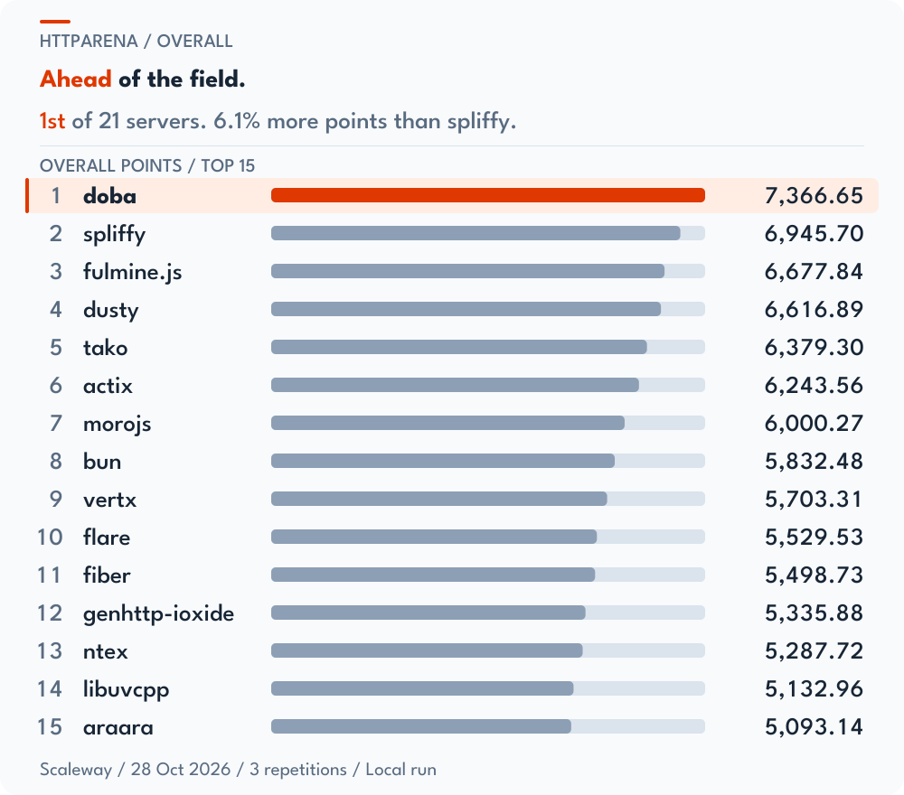
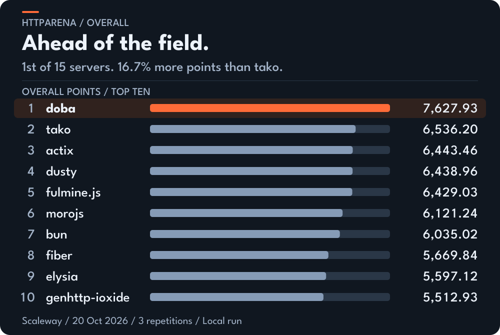
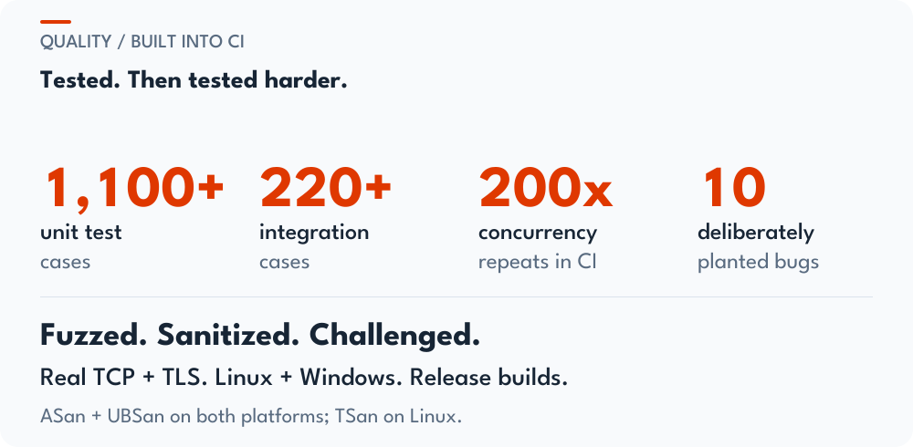
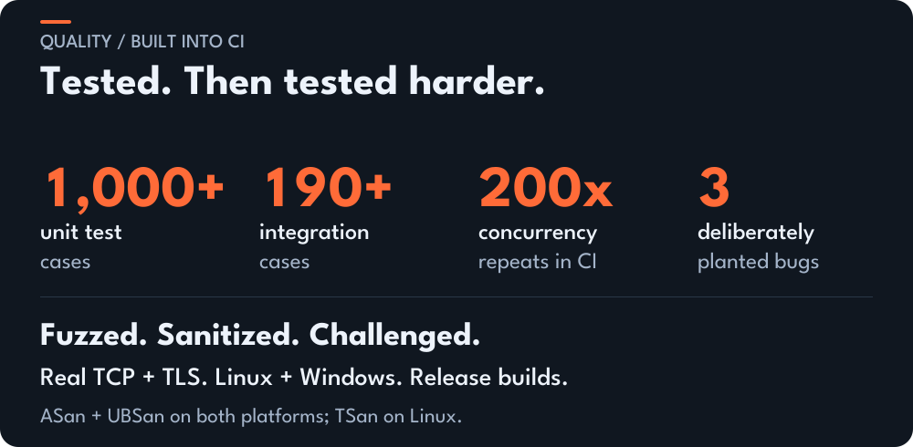

<a href="resources/branding/doba.png#gh-light-mode-only">
  
</a>
<a href="resources/branding/doba-dark.png#gh-dark-mode-only">
  
</a>
<br><br>

<a href="resources/readme/readme-hero.svg#gh-light-mode-only">
  
</a>
<a href="resources/readme/readme-hero-dark.svg#gh-dark-mode-only">
  
</a>
<br><br>

[](https://github.com/martianlabs/doba/actions/workflows/ci.yml?query=branch%3Amain)

**Meet doba:** a header-only C++20 server framework. Protocols and transports
mind their own business. HTTP/1.1 comes first; the architecture leaves room
for more.

**Native IOCP on Windows. Native epoll on Linux.**
The TCP transport needs no external libraries; optional TLS uses OpenSSL.

[Try the examples](examples/README.md)

<a name="okay-how-fast"></a>
<h2>
  <a href="resources/readme/readme-performance.svg#gh-light-mode-only">
    
  </a>
  <a href="resources/readme/readme-performance-dark.svg#gh-dark-mode-only">
    
  </a>
</h2>

Big throughput numbers are fun. Waiting for a response isn't. Let's look at both.

Measured on **Scaleway, 2026-10-20**, using the official HttpArena suite:
native **gcannon** and **wrk**, with **zrk** and servers in Docker, following
upstream CPU affinity and host tuning. **RUNS=3**. Results are selected by
upstream from its repetitions, not averaged across runs.
The campaign's reference-model verification is **incomplete**; these are
local results, not the published HttpArena leaderboard.

Every chart shows the **same top 10 from the overall ranking**, ordered by each
test's metric. Scores retain normalization across all **15 measured servers**.
The total includes eight scored profiles and the upstream completeness factor;
**pipelined**, **latency-500k-8cpu** and **static-tls** are reference-only profiles.
Failed and skipped measurements are shown explicitly; they are not measured zeroes.

The test machine uses an **AMD EPYC 8534P at 2.30 GHz**
(**64 cores / 128 threads**), **576 GiB of DDR5 RAM** and
**2 x 3.84 TB NVMe** storage. It provides a **25 Gbps private network**
and a **1 Gbps public connection**, upgradable to **25 Gbps**.

<a href="resources/benchmarks/benchmark-summary.svg#gh-light-mode-only" title="Open full-size light card">
  <picture>
    <source media="(max-width: 600px)" srcset="resources/benchmarks/benchmark-summary-narrow.svg">
    
  </picture>
</a>
<a href="resources/benchmarks/benchmark-summary.svg#gh-dark-mode-only" title="Open full-size light card">
  <picture>
    <source media="(max-width: 600px)" srcset="resources/benchmarks/benchmark-summary-narrow-dark.svg">
    
  </picture>
</a>

[See the full ranking, all 11 workloads, and machine specs](docs/benchmarks/README.md).

<a name="no-magic-a-few-deliberate-choices"></a>
<h2>
  <a href="resources/readme/readme-design.svg#gh-light-mode-only">
    
  </a>
  <a href="resources/readme/readme-design-dark.svg#gh-dark-mode-only">
    
  </a>
</h2>

*A few deliberate choices.*

- **HTTP does HTTP. I/O does I/O.** Protocols handle message rules; transports
  move bytes. The same HTTP implementation runs on both native backends.

- **Copies should earn their keep.** Metadata views, explicit ownership, and
  a fixed buffer for small responses help avoid unnecessary copies.
  Not "zero-copy everything". Just deliberate data movement.

- **Handlers run directly.** Synchronous execution preserves request order
  without a separate response scheduler.

<a name="hello-world-lets-not-overcomplicate-it"></a>
<h2>
  <a href="resources/readme/readme-hello.svg#gh-light-mode-only">
    
  </a>
  <a href="resources/readme/readme-hello-dark.svg#gh-dark-mode-only">
    
  </a>
</h2>

*Let's not overcomplicate it.*

```cpp
#include "common/signaler.h"
#include "http_server.h"

using namespace martianlabs::doba::common;
using namespace martianlabs::doba::protocol::http::v11;

int main() {
  martianlabs::doba::http_server<> srv({.ip = "0.0.0.0", .port = "8080"});
  srv.add_route(
      "GET", "/hello",
      [](const request&, response& res) {
        res.ok_200();
        res.add_header("Content-Type", "text/plain")
            .set_body("hello from doba");
      });
  srv.start();
  signaler::wait();
}
```

Once running: `curl http://localhost:8080/hello`

**Build & integrate**

<details>
<summary>Build, install, and use with CMake</summary>

With a C++20 compiler and CMake 3.20 or later, build the bundled examples and
tests, then install the headers and package configuration:

```sh
cmake -S . -B out/build/release -DCMAKE_BUILD_TYPE=Release
cmake --build out/build/release --config Release
cmake --install out/build/release --config Release --prefix out/install/release
```

In your application:

```cmake
find_package(doba CONFIG REQUIRED)
target_link_libraries(application PRIVATE martianlabs::doba)
```

For TLS, configure with `-DDOBA_ENABLE_TLS=ON` and link
`martianlabs::doba_tls`. OpenSSL is required for this optional transport.
See the [HTTPS example](examples/http/v11/https_hello_world/README.md).

Set `CMAKE_PREFIX_PATH` to the installation prefix when it is not in a
standard system location. The exported target provides the include directory,
C++20 requirement, and system threading dependency.

</details>

<a name="fast-is-nice-correct-is-non-negotiable"></a>
<h2>
  <a href="resources/readme/readme-correctness.svg#gh-light-mode-only">
    
  </a>
  <a href="resources/readme/readme-correctness-dark.svg#gh-dark-mode-only">
    
  </a>
</h2>

*Correct is non-negotiable.*

We like a good benchmark as much as the next person. But if a server needs
well-behaved clients and a bit of luck to stay up, the numbers can wait.
Here's what we put doba through before letting it brag about being fast.

<a href="resources/readme/quality-summary.svg#gh-light-mode-only" title="Open full-size light card">
  <picture>
    <source media="(max-width: 600px)" srcset="resources/readme/quality-summary-narrow.svg">
    
  </picture>
</a>
<a href="resources/readme/quality-summary.svg#gh-dark-mode-only" title="Open full-size light card">
  <picture>
    <source media="(max-width: 600px)" srcset="resources/readme/quality-summary-narrow-dark.svg">
    
  </picture>
</a>

An empty buffer. A header that's almost legal. A body that fits the limit
exactly, followed by one that misses it by a single byte. This is where
"surely nobody would send that" goes to die.

The [unit suite](tests/unit) checks HTTP parsing, raw and chunked bodies,
routing, authentication, storage, and who actually owns those bytes once
the buffer gets reused. Small details. Expensive bugs.

That lovely request from the example? It may turn up in pieces, with three
more requests behind it, from a client that hangs up halfway through.
The [integration suite](tests/integration) runs actual TCP and TLS servers
and makes those situations happen, including shutdown while work is still
in flight.

We also send hostile requests with another request right behind them.
Rejecting the first is only half the job: the second mustn't sneak through
to a handler while everyone's busy showing the first one the door.

Request two finishes before request one. Meanwhile, another receive lands,
shutdown starts, and a callback turns up late. You don't want to discover
what that combination does on somebody else's server.

So we suspend handlers and choose when to release them. We check response
order and object lifetimes at those awkward overlaps, then repeat the
[critical interleavings](tests/unit/protocol/http/v11/engine_concurrency_tests.cpp)
**200 times under ThreadSanitizer** in CI. The scheduler doesn't get to
decide whether we exercised the interesting bit today.

One client reads in tiny mouthfuls. Another resets the connection.
Handlers are suspended, bodies spill to disk, and several TCP and TLS
clients are doing this at once. Then we drain the server, restart it,
and give the [resilience suite](tests/integration/protocol/http/v11/server_resilience_tests.cpp)
another go.

Surviving isn't the whole check. Did the payloads arrive in order? Are the
handlers gone? Did we leave temporary files lying around? We check
handles/descriptors after draining and record memory use after warmup.
"It didn't crash" is a fairly low bar for a server.

We can dream up plenty of bad HTTP. libFuzzer has more time for this sort
of thing, and considerably less taste.

Our [HTTP decoder and chunked harnesses](tests/fuzz/README.md) feed its bytes
through checks for consumption, message boundaries, fragmentation, buffer
ownership, and memory/disk storage. Each harness gets **60 seconds per CI
run on Linux and Windows** under AddressSanitizer and UndefinedBehaviorSanitizer,
using a cached corpus so it doesn't start from scratch every time.

When an input breaks something, we keep it. That particular nonsense now
has a permanent seat in the test suite.

A green tick looks reassuring. You can also get one from a test that checks
absolutely nothing useful.

The [mutation checks](tests/mutation/README.md) deliberately sabotage private
copies of the headers: remove a body limit, break response ordering, let
requests reach a handler after rejection. Three bugs we very much want
caught. Each has to trip its intended assertion, while the original code
passes. If the broken version gets a green tick too, we've got work to do.

Nothing like spending an afternoon debugging the server and finding out
the test runner was lying to you.

Ours gets its own [unit](tests/unit/helpers/test_helper_tests.cpp) and
[integration](tests/integration/helpers/test_helper_tests.cpp) metatests:
filters must select the right cases, failures must get reported, and
exceptions, timeouts, and cleanup paths must behave. A stuck test gets a
deadline and a name in the report, so you have somewhere better to start
than "well, CI hung."

All of this has to get past the [CI matrix](.github/workflows/ci.yml):
**GCC and Clang on Linux**, **MSVC on Windows**, strict warnings enabled.
Linux runs **ASan, UBSan, and TSan with TLS**; Windows runs **ASan and UBSan
with TLS**, including a Clang build alongside MSVC. Both platforms repeat
the critical concurrency cases **200 times**; TSan checks for races on Linux.
And yes, **the tests run in Release, optimizations and all**. That's the code
we care about running. Debug gets a compile check. The test tooling uses
C++ and CMake; building doba is quite enough setup for testing doba.

We also check **CMake 3.20** and build and run separate applications using
both the installed package and **add_subdirectory**. It would be a bit
embarrassing if the library only worked inside its own build directory.

Fancy a second opinion? There are also adapters for manual protocol checks
with [h1spec](compliance/http/v11/h1spec/README.md) and
[Http11Probe](compliance/http/v11/http11probe/README.md). We wrote the server
and the tests; letting somebody else's tools have a go seems only fair.

[Inside the test suites](tests/README.md)

---

[Apache 2.0](LICENSE)
