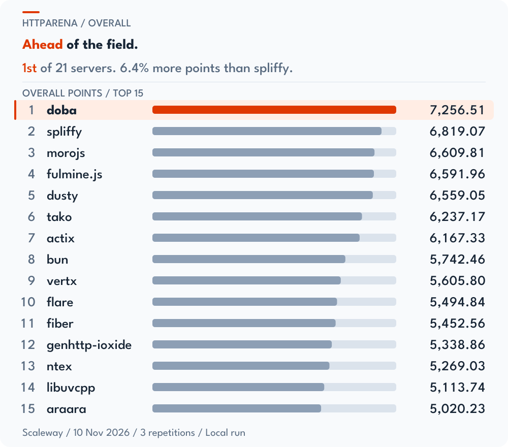
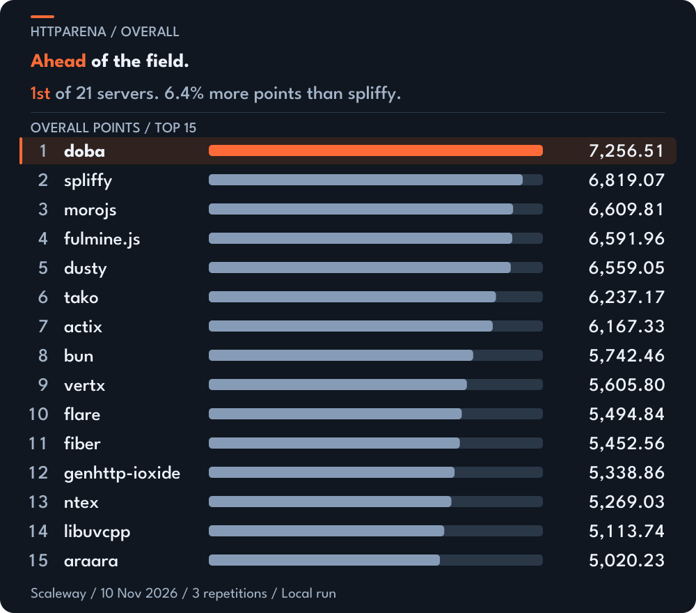
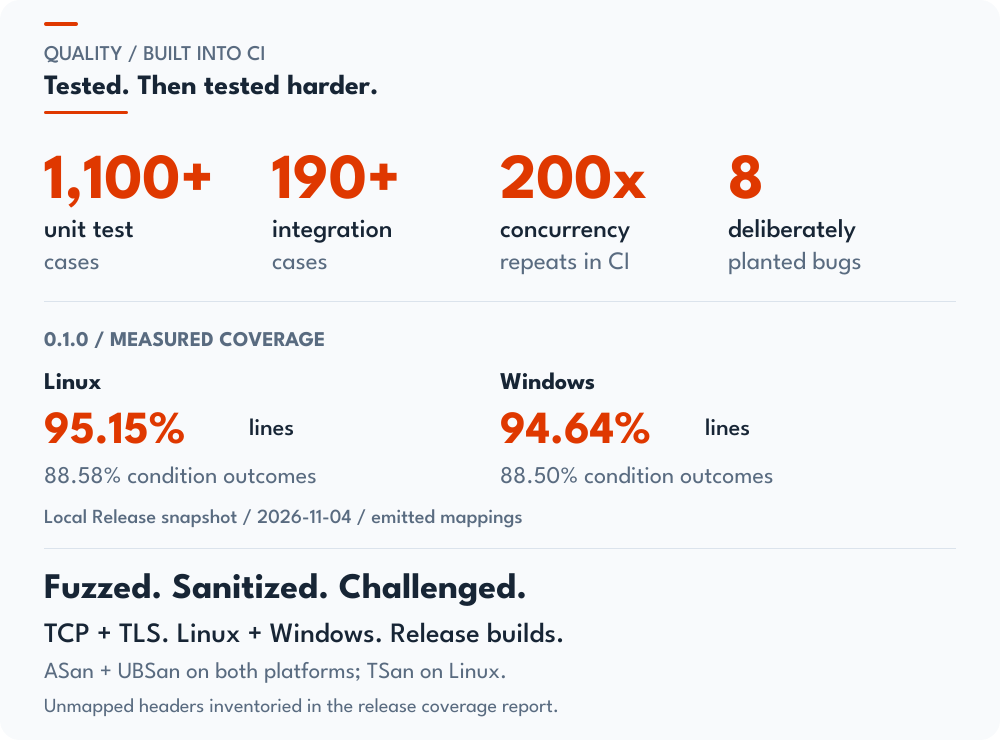
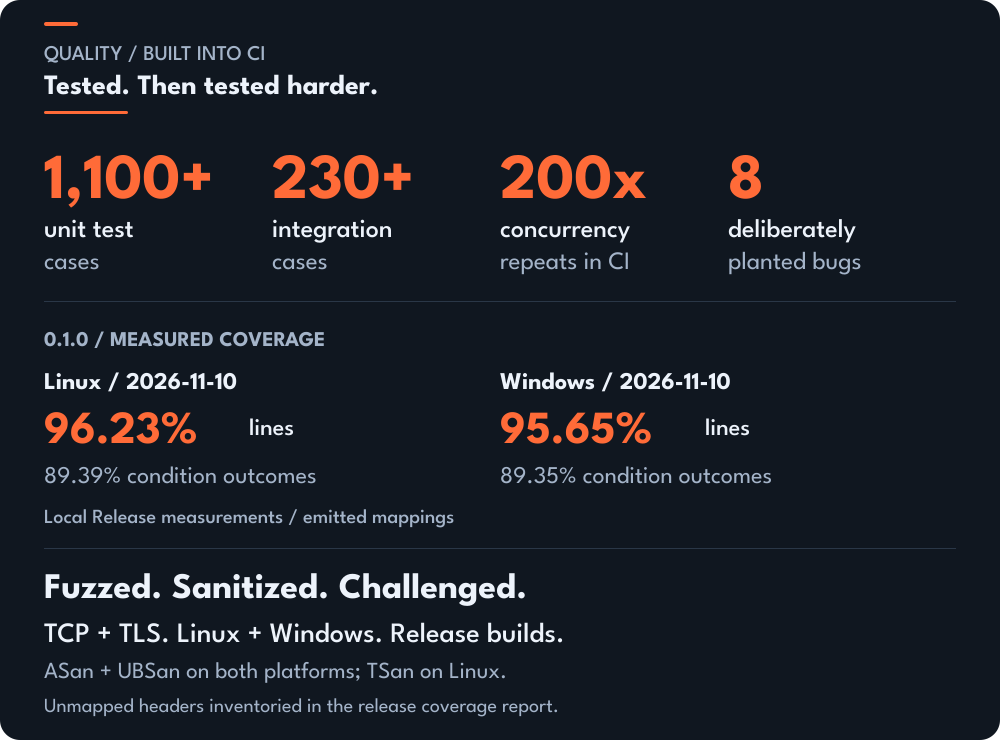

<a href="resources/branding/doba.png#gh-light-mode-only">
  
</a>
<a href="resources/branding/doba-dark.png#gh-dark-mode-only">
  
</a>
<br><br>

<a href="resources/readme/readme-hero.svg#gh-light-mode-only">
  
</a>
<a href="resources/readme/readme-hero-dark.svg#gh-dark-mode-only">
  
</a>
<br><br>

[](https://github.com/martianlabs/doba/actions/workflows/ci.yml?query=branch%3Amain)

**Meet doba**, a header-only C++20 framework for building servers on Linux
and Windows. Bring your own protocol or use the HTTP/1.1 engine that ships
with doba. Both work over TCP, with optional TLS when you need encryption.

[Read the docs](docs/README.md)

<a name="okay-how-fast"></a>
<h2>
  <a href="resources/readme/readme-performance.svg#gh-light-mode-only">
    
  </a>
  <a href="resources/readme/readme-performance-dark.svg#gh-dark-mode-only">
    
  </a>
</h2>

Big throughput numbers are fun. Waiting for a response is not. Let's look at both.

On **10 November 2026**, doba finished **first of 21 servers** in our local
run of the official HttpArena HTTP/1.1 suite on Scaleway. The chart shows
the top 15 by overall score.

The test machine uses an **AMD EPYC 8534P at 2.30 GHz**
(**64 cores / 128 threads**), **576 GiB of DDR5 RAM** and
**2 x 3.84 TB NVMe** storage. It provides a **25 Gbps private network**
and a **1 Gbps public connection**, upgradable to **25 Gbps**.

<a href="resources/benchmarks/benchmark-summary.svg#gh-light-mode-only" title="Open full-size light card">
  <picture>
    <source media="(max-width: 600px)" srcset="resources/benchmarks/benchmark-summary-narrow.svg">
    
  </picture>
</a>
<a href="resources/benchmarks/benchmark-summary-dark.svg#gh-dark-mode-only" title="Open full-size dark card">
  <picture>
    <source media="(max-width: 600px)" srcset="resources/benchmarks/benchmark-summary-narrow-dark.svg">
    
  </picture>
</a>

[See all 11 workloads, peak RAM, and how we measured them](docs/benchmarks/README.md).

<a name="no-magic-a-few-deliberate-choices"></a>
<h2>
  <a href="resources/readme/readme-design.svg#gh-light-mode-only">
    
  </a>
  <a href="resources/readme/readme-design-dark.svg#gh-dark-mode-only">
    
  </a>
</h2>

Your protocol decides what counts as a message and how to reply. The
transport looks after the connection and moves the bytes. Want to encrypt
the conversation later? You can switch to TLS and keep the protocol you
already wrote.

[How protocols and transports fit together](docs/guide/02-core-model.md)

<a name="hello-world-lets-not-overcomplicate-it"></a>
<h2>
  <a href="resources/readme/readme-hello.svg#gh-light-mode-only">
    
  </a>
  <a href="resources/readme/readme-hello-dark.svg#gh-dark-mode-only">
    
  </a>
</h2>

*Let's not overcomplicate it.*

```cpp
#include "common/signaler.h"
#include "http_server.h"

using namespace martianlabs::doba::common;
using namespace martianlabs::doba::protocol::http::v11;

int main() {
  martianlabs::doba::http_server<> srv({.ip = "0.0.0.0", .port = "8080"});
  srv.add_route(
      "GET", "/hello",
      [](const request&, response& res) {
        res.ok_200();
        res.add_header("Content-Type", "text/plain")
            .set_body("hello from doba");
      });
  srv.start();
  signaler::wait();
}
```

[Build and run your first server](docs/guide/01-getting-started.md)

<a name="fast-is-nice-correct-is-non-negotiable"></a>
<h2>
  <a href="resources/readme/readme-correctness.svg#gh-light-mode-only">
    
  </a>
  <a href="resources/readme/readme-correctness-dark.svg#gh-dark-mode-only">
    
  </a>
</h2>

*Correct is non-negotiable.*

We like a good benchmark as much as the next person. But if a server needs
well-behaved clients and a bit of luck to stay up, the numbers can wait.
Here's what we put doba through before letting it brag about being fast.

<a href="resources/readme/quality-summary.svg#gh-light-mode-only" title="Open full-size light card">
  <picture>
    <source media="(max-width: 600px)" srcset="resources/readme/quality-summary-narrow.svg">
    
  </picture>
</a>
<a href="resources/readme/quality-summary.svg#gh-dark-mode-only" title="Open full-size light card">
  <picture>
    <source media="(max-width: 600px)" srcset="resources/readme/quality-summary-narrow-dark.svg">
    
  </picture>
</a>

And yes, **the normal suite runs in Release, optimizations and all**. That's
the code we care about running.

[See what we test and how we measure coverage](docs/coverage/README.md)

---

[Apache 2.0](LICENSE)
